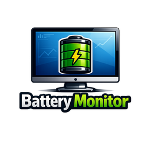

ENGLISH

# 🔋 Battery Monitor for Home Assistant

A custom integration to **monitor all battery entities** in Home Assistant and get an instant overview of:
- how many batteries you’re monitoring
- how many are **below the threshold**
- how many are at **0%**
- which one is the **lowest battery**
- a **ready-to-use list** of devices below the threshold

> Perfect for Zigbee setups (ZHA / Zigbee2MQTT), Wi-Fi devices, and any integration that exposes battery sensors.


[](https://www.buymeacoffee.com/domoticafacile)

[](https://analytics.home-assistant.io/custom_integrations.json)

[](https://www.facebook.com/groups/domoticafacile)
[](https://www.facebook.com/domoticafacile)
[](https://www.youtube.com/@DomoticaFacile-it)

[](https://www.instagram.com/domoticafacile.it)
[](https://www.tiktok.com/@domoticafacile)
[](https://whatsapp.com/channel/0029Vb5qW5O4o7qPGrFbRm1T)

<p align="center">
  
</p>

📣 Do you like this integration? ⭐ Star the repository to support the project!

---

## 🎯 Features

✅ Automatic discovery of “battery” entities (`device_class: battery` + heuristic)  
✅ Advanced filters: domains, include/exclude (patterns)  
✅ **Multi-select dropdown** to include/exclude sensors (easier than writing patterns)  
✅ Summary sensors (counts + percentages + list)  
✅ Traffic-light status: **OK / WARNING / CRITICAL**  
✅ Option to **ignore 0%** when calculating the lowest battery  
✅ Option for **automatic notification** when a 0% battery appears  
✅ Clean Low List: it does not include sensors created by the Battery Monitor integration  
✅ **Last known value kept** when a battery goes unavailable — saved to disk, restored after a restart  
✅ Dedicated **Unavailable Count** sensor, with the last known value of each missing battery  
✅ **Instant updates**: sensors refresh a few seconds after any battery changes  
✅ All entities grouped under one **Battery Monitor device**, with **diagnostics** you can download  
✅ **Localized interface**: English, Italian and German

---

## ⚙️ Installation via HACS

Battery Monitor is available **directly in HACS** — no custom repository needed.

> Requires **Home Assistant 2024.12** or newer.

> If you don’t have HACS, follow the official guide: https://hacs.xyz

1. Open **HACS**
2. Search for **Battery Monitor**
3. Open it and click **Download**
4. **Restart Home Assistant**

> 🛒 On Home Assistant **2026.11 and newer** HACS is built in as **Marketplace**: go to **Settings → Marketplace** and search for **Battery Monitor** there.

---

## 🧩 Configuration

After installation:

1. Go to **Settings → Devices & services**
2. Click **Add integration**
3. Search for **Battery Monitor**
4. Complete the setup

📌 The main configuration is done via UI, and options can be changed via the integration **gear icon**.

---

## 🛠️ Available Options (Settings → Integrations → Battery Monitor → Options)

### 🔻 Low Battery Threshold (%)
- Set the percentage under which a battery is considered “low”.
- Example: threshold 20 → all batteries **≤ 20%** will appear in “Low”.

### 🔻 Critical Battery Threshold (%)
- Sets the percentage below which a battery is considered "critical."
- Example: threshold 10 → all batteries **≤ 10%** enter the "critical" list.

### 🧠 Use heuristic (include_heuristic)
If enabled, in addition to entities with `device_class: battery`, it tries to detect batteries when:
- the unit is “%” **and** “battery”/“batteria” appears in the entity_id or friendly name
- entities whose name suggests something other than a level (voltage, power, charging, current, energy, temperature…) are skipped

### 🧭 Domains to scan (scan_domains)
Default is `sensor`.
You can add other domains separated by commas if needed.

### ✅ Include / ❌ Exclude (multi-select)
- **include_entities**: if you select one or more sensors, Battery Monitor will scan **only** those.
- **exclude_entities**: selected sensors are **always excluded**.

For advanced users, the same form also has two pattern filters (fnmatch, comma separated):
- **include_patterns**: scan only the entity_ids that match, e.g. `sensor.*_battery`
- **exclude_patterns**: skip the entity_ids that match, e.g. `sensor.ups_*`

📌 Exclusions always win: an entity excluded by list or by pattern disappears from every sensor, including the retained values of unavailable batteries.

> ⚙️ Options are applied immediately when saved; sensors update within a few seconds of any battery change (plus a 5‑minute safety poll).

### 🧯 Ignore 0% for lowest battery (ignore_zero_for_lowest)
When enabled, the **Battery Monitor Lowest** sensor ignores 0% values.
Useful because some devices (especially Zigbee) may sometimes report a wrong or “stuck” 0%.

### 📴 Unavailable batteries (treat_unavailable_as_zero)

When a battery entity becomes **unavailable**, Battery Monitor keeps its **last known value** (marked as `retained` in the attributes), so a device that died at 0% is still reported at 0% and the 0% notification is **not** marked as resolved. Last known values are **saved to disk** and survive Home Assistant restarts.

By default the value is kept **until the entity is removed from Home Assistant**. With the *"Keep last known value for (hours)"* option you can set a limit instead (e.g. 168 = one week); `0` means no limit.

If *treat_unavailable_as_zero* is enabled, an unavailable battery **with no last known value** is counted as **0%**. When disabled, it is simply listed in the **Unavailable Count** sensor.

### 🔔 Notify when a 0% appears (notify_on_zero)
When enabled, Battery Monitor creates a persistent notification when at least one battery sensor is detected at 0%.

---

## 📟 Sensors created by the integration (what they do)

Below is the complete list of sensors and their practical use.

### ✅ Battery Monitor Status (`sensor.battery_monitor_status`)
Overall battery system status:
- **OK** → no battery below threshold and no 0%
- **WARNING** → at least one battery ≤ low threshold
- **CRITICAL** → at least one battery ≤ critical threshold or at 0%

🔧 Useful for: “traffic light” automations and quick dashboards.

---

### 🔢 Battery Monitor Total (`sensor.battery_monitor_total`)
Total number of **monitored batteries** (valid battery entities found).

🔧 Useful for: verifying discovery/scanning (e.g., “does it see all my batteries?”).

---

### ⚠️ Battery Monitor Low (`sensor.battery_monitor_low`)
Number of battery entities **below the threshold**.

🔧 Useful for: triggers and alerts (e.g., notify when > 0).

---

### 🔌 Battery Monitor Low Devices (`sensor.battery_monitor_low_devices`)
Number of **devices** with at least one battery below threshold.

✅ Difference vs “Low”:
- **Low** counts entities
- **Low Devices** counts devices (avoids duplicates if a device exposes multiple battery entities)

---

### 🔻 Battery Monitor Lowest (`sensor.battery_monitor_lowest`)
Shows the **lowest battery level** found (percentage).

📌 If `ignore_zero_for_lowest` is enabled, it ignores 0% values in the calculation.

---

### 🧾 Battery Monitor Low List (`sensor.battery_monitor_low_list`)
Ready-to-use text list of devices below threshold, with a traffic-light marker per battery:

```
🔴 Kitchen Sensor: 4% | 🟡 Front Door: 12% | 🟡 Garage: 18%
```

🔴 at or below the critical threshold, 🟡 at or below the low threshold.

🔧 Useful for:
- quick Lovelace list cards
- notifications without complex templates

📌 Home Assistant limits a state to 255 characters, so on large setups the text is truncated. The complete list is always available in the `items` attribute, one entry per battery with name, value and availability.

---

### 🚨 Battery Monitor Zero Count (`sensor.battery_monitor_zero_count`)
Counts how many batteries are **exactly at 0%**.

🔧 Useful for: urgent alerts (dead batteries / sensors stuck at 0).

---

### 📴 Battery Monitor Unavailable Count (`sensor.battery_monitor_unavailable_count`)
Number of monitored battery entities currently **unavailable** (attributes list them with their last known value).

---

### 📉 Battery Monitor Low Percent (`sensor.battery_monitor_low_percent`)
Percentage of batteries below threshold compared to the total.

Formula: `Low / Total * 100`

---

### 📉 Battery Monitor Zero Percent (`sensor.battery_monitor_zero_percent`)
Percentage of batteries at 0% compared to the total.

Formula: `Zero Count / Total * 100`

---

### 🧩 Battery Monitor Overview (`sensor.battery_monitor_overview`)
Technical summary sensor: the state is a total, but the real value is in the **attributes**, which may include:
- full battery list (entity_id, name, value, availability)
- threshold and counts
- useful details for advanced cards or debugging

> 📝 The list attributes (`batteries`, `items`, `entities`, …) are **not written to the recorder database**: they grow with the number of batteries and would exceed Home Assistant's 16 KiB per-state limit on large setups. They are fully available live for dashboards, templates and automations — only their history is not kept. The counters and percentages are recorded as usual.

---

## 🩺 Diagnostics

All entities are grouped under a single **Battery Monitor** device in **Settings → Devices & services → Devices**.

From there, **Download diagnostics** gives you a JSON file with the current configuration and every battery found, with its value and availability. Attach it to an issue and you spare yourself a long back and forth.

---

## 📊 Lovelace Dashboard (simple and clean)

Basic example (native):

```yaml
type: vertical-stack
cards:
  - type: picture-entity
    entity: sensor.battery_monitor_status
    show_state: false
    show_name: false
    state_image:
      OK: /battery_monitor_images/status_ok.png
      CRITICAL: /battery_monitor_images/status_critical.png
      WARNING: /battery_monitor_images/status_warning.png
    image: /battery_monitor_images/status_ok.png
    card_mod:
      style: |
        ha-card {
          width: 100px;
          max-width: 100px;
          margin: 0 auto;
        }
        #image {
          height: 100px;
          object-fit: contain;
        }
  - type: entities
    title: Stato Batterie
    entities:
      - entity: sensor.battery_monitor_status
      - entity: sensor.battery_monitor_total
      - entity: sensor.battery_monitor_low
      - entity: sensor.battery_monitor_low_devices
      - entity: sensor.battery_monitor_lowest
      - entity: sensor.battery_monitor_unavailable_count
      - entity: sensor.battery_monitor_low_list
      - entity: sensor.battery_monitor_overview
```
EN Quick guide: how to translate Battery Monitor into other languages

Home Assistant handles translations using the files inside the translations/ folder.
The language is automatically selected based on the language set in Home Assistant (Settings → System → General).

✅ Folder structure

Make sure your integration follows this structure:

```yaml
custom_components/battery_monitor/
  strings.json
  translations/
    it.json
    en.json
    de.json
    fr.json
```
strings.json contains the translation keys and base strings.

translations/ contains the translations for each language.

1) Add a new language

Create a new file inside translations/ using the language code:

English: en.json

German: de.json

French: fr.json

Spanish: es.json

Copy the structure from translations/it.json into the new file.

Translate only the text values, without changing the keys.

✅ Example:

```yaml
{
  "options": {
    "step": {
      "init": {
        "title": "Battery Monitor Options",
        "data": {
          "threshold": "Low battery threshold (%)"
        }
      }
    }
  }
}
```
2) Never change the keys

Keys must match exactly what is used in the code (config flow and options flow).
If a key is missing or different, Home Assistant will show the raw key (e.g., scan_domains).

3) Troubleshooting

If you see errors like JSONDecodeError, the file is not valid JSON (check commas and braces).

If translations do not appear, verify the file paths:

custom_components/battery_monitor/strings.json

custom_components/battery_monitor/translations/<lang>.json

---
👨‍💻 Developer

Created with ❤️ by www.domoticafacile.it

Do you have suggestions or want to contribute?
Open an issue, a pull request, or contact us through our social channels listed on the website.
---

📄 License

This project is distributed under the MIT license.
You may use, modify, and distribute it freely, as long as the original copyright is preserved.

Read the LICENSE file for full details.

[](https://www.buymeacoffee.com/domoticafacile)

---
ITALIAN

# 🔋 Battery Monitor per Home Assistant

Integrazione personalizzata per **monitorare tutte le entità batteria** presenti in Home Assistant e avere un colpo d’occhio immediato su:
- quante batterie stai monitorando
- quante sono **sotto soglia**
- quante sono a **0%**
- qual è la **batteria più scarica**
- una **lista pronta** dei dispositivi sotto soglia

> Perfetta per impianti Zigbee (ZHA / Zigbee2MQTT), Wi-Fi e qualsiasi integrazione che esponga sensori di batteria.


[](https://www.buymeacoffee.com/domoticafacile)

[](https://analytics.home-assistant.io/custom_integrations.json)

[](https://www.facebook.com/groups/domoticafacile)
[](https://www.facebook.com/domoticafacile)
[](https://www.youtube.com/@DomoticaFacile-it)

[](https://www.instagram.com/domoticafacile.it)
[](https://www.tiktok.com/@domoticafacile)
[](https://whatsapp.com/channel/0029Vb5qW5O4o7qPGrFbRm1T)

<p align="center">
  
</p>

📣 Ti piace questa integrazione? ⭐ Metti una stella al repository per supportare il progetto!

---

## 🎯 Funzionalità

✅ Scansione automatica delle entità “batteria” (device_class battery + euristica)  
✅ Filtri avanzati: domini, include/exclude (pattern)  
✅ **Selezione multipla da elenco a discesa** per includere/escludere sensori (più facile di scrivere pattern)  
✅ Sensori di riepilogo (conteggi + percentuali + lista)  
✅ Stato “semaforo”: **OK / WARNING / CRITICAL**  
✅ Opzione per **ignorare 0%** nel calcolo della batteria più scarica  
✅ Opzione per **notifica automatica** quando compare uno 0%  
✅ Low List pulita: non include i sensori creati dall’integrazione Battery Monitor  
✅ **Ultimo valore noto conservato** quando una batteria diventa non disponibile — salvato su disco e ripristinato dopo un riavvio  
✅ Sensore dedicato **Unavailable Count**, con l’ultimo valore noto di ogni batteria mancante  
✅ **Aggiornamenti immediati**: i sensori si aggiornano pochi secondi dopo ogni variazione  
✅ Tutte le entità raggruppate in un unico **dispositivo Battery Monitor**, con **diagnostica** scaricabile  
✅ **Interfaccia localizzata**: inglese, italiano e tedesco

---

## ⚙️ Installazione tramite HACS

Battery Monitor è disponibile **direttamente in HACS** — non serve aggiungere alcun repository personalizzato.

> Richiede **Home Assistant 2024.12** o successivo.

> Se non hai HACS, segui la guida ufficiale: https://hacs.xyz

1. Apri **HACS**
2. Cerca **Battery Monitor**
3. Aprila e clicca **Scarica**
4. **Riavvia Home Assistant**

> 🛒 Su Home Assistant **2026.11 e successivi** HACS è integrato come **Marketplace**: vai su **Impostazioni → Marketplace** e cerca **Battery Monitor**.

---

## 🧩 Configurazione

Dopo l’installazione:

1. Vai su **Impostazioni → Dispositivi e servizi**
2. Clicca **Aggiungi integrazione**
3. Cerca **Battery Monitor**
4. Completa il setup

📌 La configurazione principale è via UI e le opzioni sono modificabili dal tasto **ingranaggio** dell’integrazione.

---

## 🛠️ Opzioni disponibili (Impostazioni → Integrazioni → Battery Monitor → Opzioni)

### 🔻 Soglia Batteria Bassa (%)
- Imposta la percentuale sotto cui una batteria viene considerata “bassa”.
- Esempio: soglia 20 → tutte le batterie **≤ 20%** entrano nella lista “Low”.

### 🔻 Soglia Batteria Critica (%)
- Imposta la percentuale sotto cui una batteria viene considerata “critica”.
- Esempio: soglia 10 → tutte le batterie **≤ 10%** entrano nella lista “critica”.

### 🧠 Usa euristica (include_heuristic)
Se attiva, oltre alle entità con `device_class: battery`, prova a riconoscere le batterie anche quando:
- l’unità è “%” **e** nell’entity_id o nel nome compare “battery”/“batteria”
- le entità che sembrano altro (voltage, power, charging, current, energy, temperature…) vengono ignorate

### 🧭 Domini da scansionare (scan_domains)
Di default è `sensor`.
Puoi aggiungere altri domini separati da virgola se necessario.

### ✅ Include / ❌ Exclude (selezione multipla)
- **include_entities**: se selezioni uno o più sensori, Battery Monitor considera **solo** quelli.
- **exclude_entities**: i sensori selezionati vengono **sempre esclusi**.
  
Per utenti avanzati, nello stesso form ci sono anche due filtri pattern (fnmatch, separati da virgola):
- **include_patterns**: considera solo gli entity_id che corrispondono, es. `sensor.*_battery`
- **exclude_patterns**: ignora gli entity_id che corrispondono, es. `sensor.ups_*`

📌 Le esclusioni hanno sempre la precedenza: un’entità esclusa per elenco o per pattern sparisce da tutti i sensori, compresi i valori conservati delle batterie non disponibili.

> ⚙️ Le opzioni si applicano subito al salvataggio; i sensori si aggiornano entro pochi secondi da ogni variazione (più un polling di sicurezza ogni 5 minuti).

### 🧯 Ignora 0% per batteria più scarica (ignore_zero_for_lowest)
Quando attivo, il sensore **Battery Monitor Lowest** ignora i valori 0% nel calcolo.
Utile perché alcuni dispositivi (soprattutto Zigbee) a volte riportano 0% in modo errato o fisso.

### 📴 Batterie non disponibili (treat_unavailable_as_zero)

Quando un’entità batteria diventa **non disponibile**, Battery Monitor conserva l’**ultimo valore noto** (attributo `retained`), così un dispositivo morto a 0% continua a risultare a 0% e la notifica **non** viene segnata come risolta. Gli ultimi valori noti vengono **salvati su disco** e sopravvivono ai riavvii di Home Assistant.

Di default il valore viene conservato **finché l’entità non viene rimossa da Home Assistant**. Con l’opzione *“Conserva l’ultimo valore noto per (ore)”* puoi impostare un limite (es. 168 = una settimana); `0` significa nessun limite.

Se *treat_unavailable_as_zero* è attiva, una batteria non disponibile **senza un ultimo valore noto** viene conteggiata come **0%**. Se disattiva, viene solo elencata nel sensore **Unavailable Count**.

### 🔔 Notifica quando compare uno 0% (notify_on_zero)
Quando attivo, Battery Monitor genera una notifica persistente quando viene rilevato almeno un sensore batteria a 0%.

---

## 📟 Sensori creati dall’integrazione (cosa fanno e a cosa servono)

Di seguito l’elenco completo dei sensori e il loro utilizzo pratico.

### ✅ Battery Monitor Status (`sensor.battery_monitor_status`)
**Stato generale** dell’impianto batterie:
- **OK** → nessuna batteria sotto soglia e nessun 0%
- **WARNING** → almeno una batteria ≤ soglia bassa
- **CRITICAL** → almeno una batteria ≤ soglia critica oppure a 0%

🔧 Utile per: automazioni “semaforo”, dashboard immediate.

---

### 🔢 Battery Monitor Total (`sensor.battery_monitor_total`)
Numero totale di **batterie monitorate** (entità batteria valide trovate).

🔧 Utile per: controllare che la scansione funzioni (es. “mi vede davvero tutte le batterie?”).

---

### ⚠️ Battery Monitor Low (`sensor.battery_monitor_low`)
Numero di entità batteria **sotto soglia**.

🔧 Utile per: trigger automazioni e alert (es. notifica se > 0).

---

### 🔌 Battery Monitor Low Devices (`sensor.battery_monitor_low_devices`)
Numero di **dispositivi** con almeno una batteria sotto soglia.

✅ Differenza con “Low”:
- **Low** conta le entità
- **Low Devices** conta i device (evita duplicati se un device espone più entità)

---

### 🔻 Battery Monitor Lowest (`sensor.battery_monitor_lowest`)
Mostra la **batteria più scarica** trovata (in percentuale).

📌 Se `ignore_zero_for_lowest` è attivo, ignora i valori 0% nel calcolo.

---

### 🧾 Battery Monitor Low List (`sensor.battery_monitor_low_list`)
Lista testuale pronta dei dispositivi sotto soglia, con un indicatore “semaforo” per ogni batteria:

```
🔴 Sensore Cucina: 4% | 🟡 Porta Ingresso: 12% | 🟡 Garage: 18%
```

🔴 pari o sotto la soglia critica, 🟡 pari o sotto la soglia bassa.

🔧 Utile per:
- card Lovelace “lista rapida”
- notifiche già pronte senza template complessi

📌 Home Assistant limita lo stato a 255 caratteri, quindi negli impianti grandi il testo viene troncato. L’elenco completo è sempre disponibile nell’attributo `items`, una voce per batteria con nome, valore e disponibilità.

---

### 🚨 Battery Monitor Zero Count (`sensor.battery_monitor_zero_count`)
Conta quante batterie sono **esattamente a 0%**.

🔧 Utile per: alert urgenti (batterie finite / sensori bloccati su 0).

---

### 📴 Battery Monitor Unavailable Count (`sensor.battery_monitor_unavailable_count`)
Numero di entità batteria monitorate attualmente **non disponibili** (negli attributi l’elenco con l’ultimo valore noto).

---

### 📉 Battery Monitor Low Percent (`sensor.battery_monitor_low_percent`)
Percentuale di batterie sotto soglia rispetto al totale.

Formula: `Low / Total * 100`

---

### 📉 Battery Monitor Zero Percent (`sensor.battery_monitor_zero_percent`)
Percentuale di batterie a 0% rispetto al totale.

Formula: `Zero Count / Total * 100`

---

### 🧩 Battery Monitor Overview (`sensor.battery_monitor_overview`)
Sensore “tecnico” di riepilogo: il valore è un totale, ma negli **attributi** trovi spesso:
- elenco completo batterie (entity_id, nome, valore, disponibile)
- soglia e conteggi
- dettagli utili per card avanzate o debug

> 📝 Gli attributi a elenco (`batteries`, `items`, `entities`, …) **non vengono scritti nel database del recorder**: crescono col numero di batterie e supererebbero il limite di 16 KiB per stato di Home Assistant negli impianti grandi. Restano pienamente disponibili in tempo reale per dashboard, template e automazioni: non viene conservato solo il loro storico. Conteggi e percentuali vengono registrati come sempre.

---

## 🩺 Diagnostica

Tutte le entità sono raggruppate in un unico dispositivo **Battery Monitor**, in **Impostazioni → Dispositivi e servizi → Dispositivi**.

Da lì, **Scarica diagnostica** produce un file JSON con la configurazione attuale e tutte le batterie trovate, con valore e disponibilità. Allegandolo a una segnalazione si evita un lungo scambio di messaggi.

---

## 📊 Dashboard Lovelace (semplice e pulita)

Esempio base (nativa):

```yaml
type: vertical-stack
cards:
  - type: picture-entity
    entity: sensor.battery_monitor_status
    show_state: false
    show_name: false
    state_image:
      OK: /battery_monitor_images/status_ok.png
      CRITICAL: /battery_monitor_images/status_critical.png
      WARNING: /battery_monitor_images/status_warning.png
    image: /battery_monitor_images/status_ok.png
    card_mod:
      style: |
        ha-card {
          width: 100px;
          max-width: 100px;
          margin: 0 auto;
        }
        #image {
          height: 100px;
          object-fit: contain;
        }
  - type: entities
    title: Stato Batterie
    entities:
      - entity: sensor.battery_monitor_status
      - entity: sensor.battery_monitor_total
      - entity: sensor.battery_monitor_low
      - entity: sensor.battery_monitor_low_devices
      - entity: sensor.battery_monitor_lowest
      - entity: sensor.battery_monitor_unavailable_count
      - entity: sensor.battery_monitor_low_list
      - entity: sensor.battery_monitor_overview
```
---
🇮🇹 Guida rapida: come tradurre Battery Monitor in altre lingue

Home Assistant gestisce le traduzioni tramite i file nella cartella translations/.
La lingua usata dipende automaticamente dalla lingua impostata in Home Assistant (Impostazioni → Sistema → Generale).

✅ Struttura delle cartelle

Assicurati che la tua integrazione abbia questa struttura:
```yaml
custom_components/battery_monitor/
  strings.json
  translations/
    it.json
    en.json
    de.json
    fr.json
```

strings.json contiene le chiavi e i testi base.

translations/ contiene le traduzioni per ogni lingua.

1) Aggiungere una nuova lingua

Crea un nuovo file nella cartella translations/ con il codice lingua:

Inglese: en.json

Tedesco: de.json

Francese: fr.json

Spagnolo: es.json

Copia la struttura di translations/it.json dentro il nuovo file.

Traduci solo i testi (valori), senza cambiare le chiavi.

✅ Esempio:

```yaml
{
  "options": {
    "step": {
      "init": {
        "title": "Battery Monitor Options",
        "data": {
          "threshold": "Low battery threshold (%)"
        }
      }
    }
  }
}
```
2) Non cambiare mai le chiavi

Le chiavi devono combaciare esattamente con quelle usate nel codice (config flow e options flow).
Se una chiave non esiste o è diversa, Home Assistant mostrerà il nome grezzo (es. scan_domains).

3) Troubleshooting

Se vedi errori tipo JSONDecodeError, il file non è un JSON valido (attenzione a virgole e parentesi).

Se le traduzioni non compaiono, verifica i percorsi:

custom_components/battery_monitor/strings.json

custom_components/battery_monitor/translations/<lang>.json

---

👨‍💻 Sviluppatore

Realizzato con ❤️ da www.domoticafacile.it

Hai suggerimenti o vuoi contribuire?
Apri una issue, una pull request o contattaci tramite i nostri canali social che trovi sul sito.

---

## 📄 Licenza

Questo progetto è distribuito sotto licenza **MIT**.  
Puoi usarlo, modificarlo e distribuirlo liberamente, purché venga mantenuto il copyright originario.

Leggi il file [LICENSE](LICENSE) per i dettagli completi.

---

❤️ Supporta Domotica Facile

Se questa integrazione ti è stata utile e ti ha fatto risparmiare tempo (e batterie 😄), puoi darci una mano concreta a continuare 💪🏡

Ogni guida, integrazione e test richiede tempo, studio e tanta passione.
Con un piccolo contributo puoi supportare lo sviluppo di nuovi progetti, articoli e integrazioni come questa.

☕ Offrici un caffè e sostieni Domotica Facile

[](https://www.buymeacoffee.com/domoticafacile)

Anche un gesto simbolico fa la differenza.
Grazie di cuore per il tuo supporto ❤️🔋
